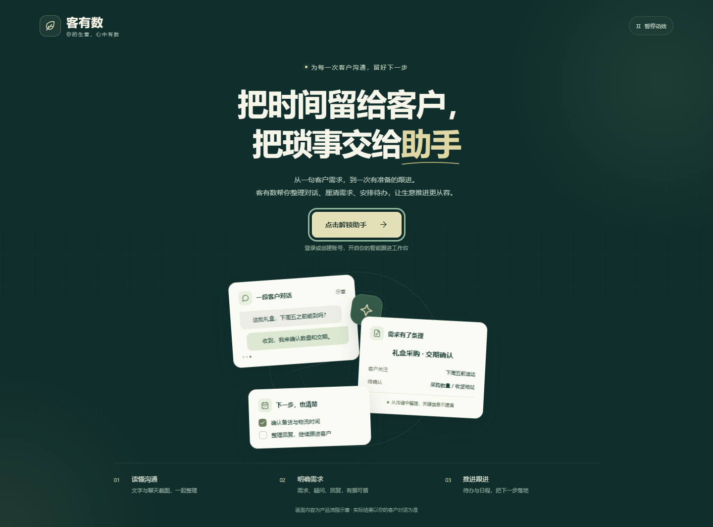
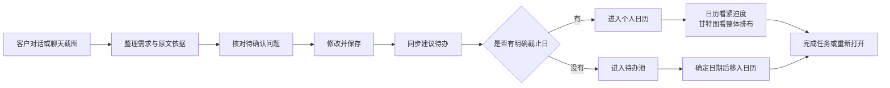
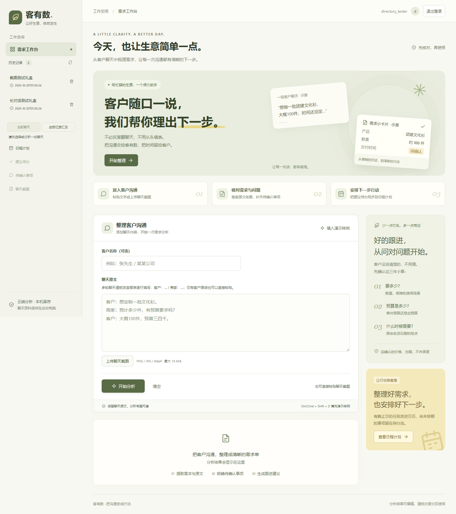
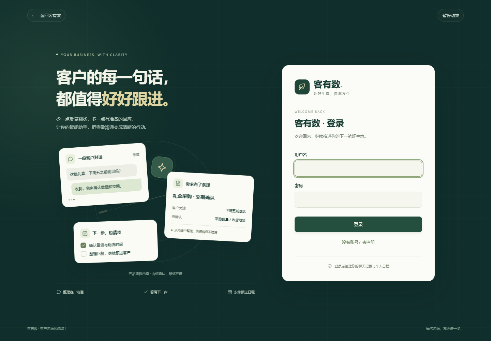
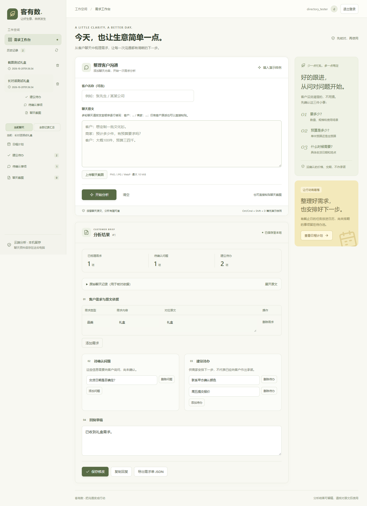
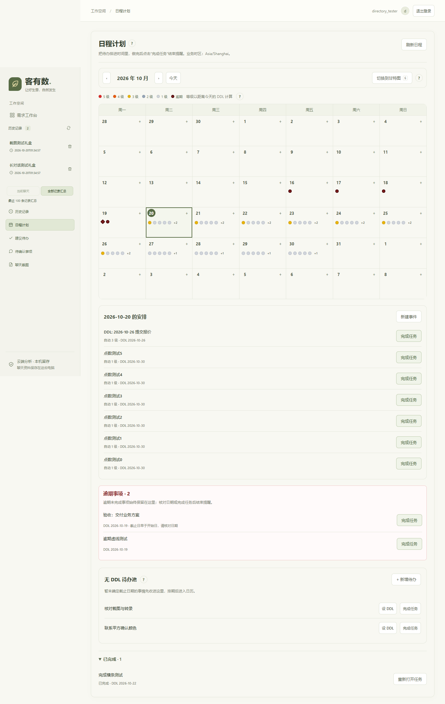

# 客有数：智能销售助手

## 产品说明书与商业计划书（方向稿）

**版本：** 方向稿 1.0
**日期：** 2026 年 10 月 20 日
**编写依据：** 当前仓库源码、当前可达的 58 条提交记录（按最近 100 条范围检查）、现有验收文档、界面文案、运行记录与设计说明
**面向读者：** 销售总监、业务负责人、商务运营、产品与设计团队、潜在合作方

> **阅读约定**
>
> - ✅ 当前版本已经实现，并有代码或运行记录支持。
> - ⚠️ 当前可用，但存在明确边界，销售使用时仍然需要人工核对。
> - 🧭 商业计划中的未来方向，不代表现在已经具备。
> - 💡 商业假设，需要通过客户访谈、试用数据和付费测试验证。
> - 产品说明正文尽量使用销售能理解的语言；技术证据集中在附录。

---

## 目录

### 产品说明书

1. [产品定位](#1-产品定位)
2. [核心使用场景](#2-核心使用场景)
3. [一条完整的销售工作路径](#3-一条完整的销售工作路径)
4. [功能清单](#4-功能清单)
5. [产品独特性](#5-产品独特性)
6. [界面与文案风格](#6-界面与文案风格)
7. [当前能力边界](#7-当前能力边界)

### 商业计划书（方向稿）

8. [商业判断与验证前提](#8-商业判断与验证前提)
9. [目标用户与市场切入](#9-目标用户与市场切入)
10. [盈利方向](#10-盈利方向)
11. [产品演进路线](#11-产品演进路线)
12. [获客方式与增长路径](#12-获客方式与增长路径)
13. [验证指标与决策关口](#13-验证指标与决策关口)
14. [风险与经营边界](#14-风险与经营边界)

### 附录

- [A. 当前能力与未来方向对照](#附录-a-当前能力与未来方向对照)
- [B. 当前限制与待改进项](#附录-b-当前限制与待改进项)
- [C. 代码与历史证据索引](#附录-c-代码与历史证据索引)

---

# 产品说明书

## 1. 产品定位

**客有数是一款面向销售人员、商务人员和中小商家的智能销售助手。** 它把散落在聊天里的客户需求、尚未确认的问题、下一步行动和回复草稿整理出来，并让这些内容继续进入历史记录、待办和日历，减少销售“聊完以后再手抄一遍”的工作。

当前产品最明确的落地起点是接受文化衫定制订单的小微商家，但界面与业务表达已经扩展到更普遍的销售和商务沟通。它处理的核心问题不是“再做一个待办清单”，而是缩短从一段客户对话到下一步行动之间的距离。

一句话概括：

> **把每次客户沟通，整理成一份能核对、能修改、能继续执行的跟进计划。**

【此处配截图：销售粘贴客户对话后得到的四类结果】

## 2. 核心使用场景

### 场景 A：聊完一大段，立即整理出下一步

一位销售刚在微信或飞书里和客户聊完定制需求。双方先讨论数量，再提到预算、交期和设计稿，中间还改过一次数量。销售把聊天原文粘贴进来，或者直接上传聊天截图，点击“开始分析”。

客有数会分成四块给出结果：

- **客户需求**：数量、预算、用途、设计要求等已经明确的信息。
- **待确认问题**：客户还没说清的数量、预算、时间和责任。
- **建议待办**：销售下一步可以做什么。
- **回复草稿**：一段可以继续和客户沟通的话。

每一条已确认需求都能看到对应原话。销售可以先核对，再修改和保存，避免把智能助手的建议当成客户已经答应的条件。

### 场景 B：第二天打开日历，先处理最逼近截止日的事情

销售早上进入工作台，切到日历。月视图里，每一天会显示当天仍在推进的事项。**圆点数量表示当天有多少事情在进行，圆点颜色表示这些事项距离截止日有多急。**

如果有多件事同时进入最急区间，就会看到多个红点；如果只有一件事很急，也会看到一个红点。因此，看今天的工作压力要同时看“有多少个圆点”和“颜色有多深”，不能只看红点总数。

### 场景 C：事情还没定时间，先放进待办池

销售知道“要补一份尺码表”“要问客户设计偏好”，但现在还没有截止日期。这时可以只填写标题，把事项先放进**无截止日期的待办池**。之后客户确认了时间，再给这条待办设定截止日期，它就会进入日历并参与紧迫颜色计算。

### 场景 D：下周要跑几个客户，切到甘特图看整体排布

日历切到甘特图后，每一行代表一件事，横轴是一段时间。横条从开始日延伸到截止日；已经逾期但还没完成的部分，会用虚线继续延伸到今天。销售可以按日或按周查看，先判断哪些事项挤在同一时间段，再决定怎样安排客户拜访和交付准备。

> 当前甘特图用于个人事项的时间排布，不是多人资源调度，也不统计每个任务实际花了多少小时。

### 场景 E：回到历史记录，找到当时答应过什么

销售在准备下一次跟进时，可以打开历史记录，查看过去的聊天、原始截图和当时的分析结果。历史记录旁边还提供“建议待办”“待确认事项”“聊天截图”三个同级入口；每一条历史记录下也能直接进入这三种内容。长原文默认折叠，需要时再展开核对。

### 场景 F：事情做完，主动结束日历里的提醒

销售完成“提交设计稿”之后，打开这条事项，点击“完成任务”。它会从当前日历中消失，并保留完成记录；如果后来又需要继续，可以重新打开。删除事项与完成任务是两种不同操作，前者会移除事项，后者会留下完成记录。

## 3. 一条完整的销售工作路径

当前智能助手支持的输入是：

- 一段粘贴或输入的聊天文字。
- 一张 PNG、JPG 或 WebP 聊天截图，最大 10 MiB。
- 可以同时填写客户名称；客户名称不是要求必填。

当前**不能直接导入 Word、PDF、Excel，不能自动连接微信或飞书读取聊天，也不能一次上传多张截图**。页面中的“填入演示样例”和 Ctrl/Cmd + Shift + D 只用于演示，不会替用户访问真实聊天。

【此处配截图：粘贴长对话、上传截图和开始分析】

## 4. 功能清单

### 4.1 欢迎、注册与登录

✅ 当前版本先展示动态欢迎页，用户通过“点击解锁助手”进入登录或注册。视觉上用客户对话、需求卡片和跟进事项演示产品如何工作。

✅ 新用户可以注册，用户名不能重复；密码提示写明长度为 10–128 个字符，不强制大小写或特殊符号，并建议混合使用字母、数字和符号。重复注册“张三”这类已有用户名时，页面会提示“用户名已存在，请更换用户名。”

✅ 登录后进入个人工作空间。普通账号看到自己的聊天记录；个人日历按账号隔离。管理员账号可以进入后台统计，但当前系统也不允许管理员直接读写别人的个人日历。

⚠️ 当前没有找回密码和邮箱验证流程。用户忘记密码时需要由现有管理流程处理。

【此处配截图：用户名重复与密码格式提示】

### 4.2 对话记录整理

#### 怎么用

1. 可选填写客户名称。
2. 粘贴一段聊天原文，或上传一张聊天截图。
3. 点击“开始分析”。
4. 等待页面显示“正在整理沟通内容，截图识别可能需要更长时间，请稍候。”
5. 先查看需求和原文依据，再处理待确认问题。
6. 修改结果后点击“保存修改”。

#### 能够得到什么

| 结果 | 用户能做什么 | 产品约束 |
| --- | --- | --- |
| 客户需求 | 查看已经明确的业务信息，并保留对应原话 | 原话必须能在输入内容中找到；不能凭空补出数量和价格 |
| 待确认问题 | 准备下一次追问，例如“要多少？”“预算是多少？”“什么时候需要？” | 信息缺失、说法冲突或角色不清时，应进入待确认 |
| 建议待办 | 安排内部下一步，例如补尺码表、准备方案 | 是建议，不代表已经对客户作出承诺 |
| 回复草稿 | 复制后继续与客户沟通 | 不会擅自承诺价格、优惠、免费设计或交期 |

当前分析还会保存截图原图和识别出的文字。用户展开“原始聊天记录（用于核对依据）”即可逐项核对。

#### 没有明确谁在说话的聊天，是否能够自动识别？

可以提交这类聊天，但当前版本**不能对任意没有标注角色的长对话保证可靠判断谁是甲方、谁是乙方**。

- 页面建议多轮聊天按“客户：…… / 商家：……”逐行填写。
- 如果一段文字只有客户原话，可以直接粘贴。
- 如果角色不明确，系统会倾向于把内容留作待确认，而不是猜一个角色后当成事实。
- 截图里气泡靠左或靠右，也不能单独证明谁一定是客户。清晰截图可以优化识别，但最终仍需人工核对证据。

#### 对日期和改口的处理

产品不会为了得到一个漂亮结果而替客户补数字或日期：

- 客户说“大概 100 件”，保留“大概”，不写成精确订单。
- 客户说“三四千”，保留预算区间。
- 客户先说 100 件、后改成 150 件，当前需求应采用 150 件。
- 客户提到 3000 元和 5000 元但没有确认，进入待确认问题。
- “10 月 30 日前”没有年份时，不自动补当前年份。
- “下周”“月底”不会自动变成具体日期。
- 只有某个待办与一个完整日期明确对应时，才把日期写入日历。

#### 编辑、复制与导出

✅ 四类结果都可以人工增删和修改。保存失败时草稿会保留，页面会提示重新处理。复制回复时会等待内容真正写入剪贴板后再提示成功。

⚠️ 当前“导出需求单”下载的是结构化 JSON 文件，尚未提供 Word、Excel 或 PDF 版本。导出前如果还有未保存修改，系统会先保存。

【此处配截图：原文依据、待确认问题和导出按钮】

### 4.3 历史记录与内容目录

✅ 历史记录保留过去整理过的聊天。当前显式汇总范围是最近 100 条当前账号可访问的记录，不是无限全量汇总。

✅ 侧边栏包含“历史记录”，并配置“建议待办”“待确认事项”“聊天截图”三个同级目录。每个目录可以查看：

- 当前聊天中的同类内容；
- 全部记录汇总中的同类内容；
- 某一条历史记录中的同类内容。

✅ 点击一条历史记录时，可在它下面直接进入该次沟通的建议待办、待确认事项或截图。

✅ 长原文默认折叠，展开后在限定区域内滚动。切换记录或账号时恢复折叠，避免长聊天挤满整个页面。

✅ 打开一条聊天后，会保留来源信息和快捷入口。刷新页面或使用浏览器前进、后退仍能恢复目录选中状态。

⚠️ 分类来自已经保存的分析结果，不会自动判断某件事是否已解决、某次追问是否已完成。任务完成状态需要回到日历和待办模块查看。

【此处配截图：当前聊天、全部记录汇总、三类目录和每份历史下的快捷入口】

### 4.4 月历与紧迫颜色

#### 怎么用

1. 从侧边栏进入日历。
2. 在某天点击空白处，新建事项。
3. 填写标题和截止日期，可补充备注；紧迫等级可以保持自动，也可以手动选择 1–5 级。
4. 保存后，在开始日到截止日之间的每一天都能看到这件事。
5. 点击圆点或事项标签，查看详情、修改截止日期、完成任务或删除。

#### 圆点和颜色代表什么

- **圆点数量**：当天有多少件尚未完成、且还没有过截止日的事情。
- 每天最多显示 5 个圆点，更多时显示“+n”，点开可查看全部。
- **颜色**：按“今天距离截止日还有几天”计算，因而同一件事在不同日期上会保持同一个当前紧迫颜色。

| 距离截止日 | 紧迫等级 | 用户看到的颜色 |
| --- | --- | --- |
| 2 天以内 | 5 级 | 醒目红色 |
| 3–4 天 | 4 级 | 橙色 |
| 5–6 天 | 3 级 | 黄色 |
| 7–8 天 | 2 级 | 灰蓝色 |
| 9 天以上 | 1 级 | 灰色 |
| 已过截止日且未完成 | 逾期 | 深红色并带描边 |

#### 手动调整紧迫等级

销售可以根据业务经验把某件事固定为 1–5 级。手动设置后，它不随剩余天数自动变化；需要恢复自动计算时，点击“恢复自动”。

⚠️ 逾期样式优先于手动等级。即使手动设为 3 级，只要过了截止日且未完成，仍然显示为逾期状态。

#### 开始日从哪里来

系统设计为优先使用分析结果提供的开始日；如果没有，就用这件事进入系统的创建时间。前端不允许销售随手填写开始日。

⚠️ 当前智能分析返回的是文字建议，还没有稳定的独立开始日。因此，当前实际运行中的事项通常从进入系统的那一天开始，而不是原始聊天发生的那一天。

#### 完成任务、删除和异常日期

- 完成任务后，活跃日历上的圆点消失，完成时间被保留。
- 已完成的记录可以在“已完成”中查看，也可以重新打开。
- “删除”会移除事项本身；它与“完成”不同。
- 截止日早于开始日时，系统不伪造一个反向区间，而是在截止日显示异常标记，提示用户核对。

【此处配截图：新建事项、手动等级、逾期描边和完成列表】

### 4.5 无截止日期的待办池

✅ 日历下方有“无 DDL 待办池”，这里暂存还没有定时间的待办。新建时只填标题就可以保存。

✅ 点击“设 DDL”并选择日期后，待办会离开池子，进入日历并开始显示圆点。之后清空截止日期，它会回到待办池。

✅ 待办池里的任务也可以直接标记完成。

⚠️ 当前界面使用“无 DDL”“设 DDL”这类偏内部简写。面向销售用户，后续可改为“待排期待办”“设置截止日期”。

【此处配截图：只填标题新增待办，再设置截止日期】

### 4.6 对话建议与日历自动衔接

✅ 新分析保存后，系统会把建议待办同步进当前账号：

- 明确写出完整截止日期的建议，进入日历。
- 没有明确日期的建议，进入待办池。
- 已同步过的事项不会因为再次保存而重复生成。
- 销售已经改过的日期、等级和完成状态不会被聊天里的新建议自动覆盖。

⚠️ 这是“把新建议继续送进日程”的增量衔接，不是聊天内容与日历之间的双向覆盖同步。再次修改建议文本时，可能新增一条新事项；原有事项需要进入日历单独调整。

⚠️ “加入待办池”按钮不会重新解析聊天中的日期，只用于把一条建议转成自己的待办。日期采用保守规则，相对日期和缺少年份的说法不会自动推算。

#### 删除聊天时会发生什么

删除聊天前，页面会明确提醒：删除这份聊天会同时删除当前账号从它同步出来的排期事项、待办池事项和已完成事项。

- 取消或删除失败时，聊天和关联事项都保留。
- 当前账号手工创建的事项不会被一起删除。
- 如果同一个来源被其他账号单独导入，其他账号的事项不受影响。

【此处配截图：删除聊天前的影响提示和确认按钮】

### 4.7 甘特图视图

✅ 点击界面切换按钮或按 `G`，可以在月历和甘特图之间切换。正在输入文字或帮助弹窗打开时，快捷键不会误触发。

✅ 每一行代表一件事，横条从开始日延伸到截止日，颜色沿用日历的紧迫颜色。

✅ 逾期且未完成的部分，从截止日次日向今天延伸，用虚线表示已经超出计划期。

✅ 可以按日或周查看，并可选择显示已完成事项。

⚠️ 当前甘特图是个人时间安排视图，不包含团队人力冲突、成本、依赖关系或实际工时记录。

【此处配截图：日刻度、周刻度和逾期虚线】

### 4.8 内置帮助

✅ 日历、手动等级、待办池、甘特图以及创建与结束事件等模块旁都有圆形小问号。

✅ 点击后显示两段白话说明和“操作步骤 → 发生什么”的流程提示，并有“知道了”按钮。

✅ 帮助浮层可以点遮罩或按 Esc 关闭，打开时不会触发 `G` 快捷键。

【此处配截图：五个帮助主题和流程步骤】

### 4.9 后台统计

✅ 管理员可以查看已登录页面的访问情况和主要功能使用次数，包括分析、历史记录、保存、导出、日历等操作。

⚠️ 后台统计用于了解系统使用情况，不是销售业绩看板，也不包含回款、成交额、客户转化或实时在线人数。个人日历属于个人业务安排，管理员不能直接查看。

【此处配截图：后台访问与功能使用统计】

## 5. 产品独特性

### 5.1 从对话直接走向行动

普通待办工具通常要求销售先读完聊天，再一条条手动输入。客有数把“客户需求、待确认问题、建议待办、回复草稿、原文证据”放在同一条工作链路里，并且可以把建议继续送入个人日历或待办池。

### 5.2 先核对，再使用

系统没有把 AI 结果包装成绝对答案，而是把事实、问题、建议和回复分开：

- 需求必须保留原文依据。
- 未确认内容进入待确认问题。
- 建议待办明确写着“不代表已经向客户作出承诺”。
- 回复草稿不自动承诺价格、优惠、免费设计或交期。

这让销售能快速复核，而不是被一段看似流畅、实际可能承诺错误的文字带偏。

### 5.3 用颜色表达销售的时间压力

月历不只显示日期，还把每件事随截止日逼近的压力直接画进日历。自动五级颜色、手动等级、逾期描边以及“圆点数量代表工作量、颜色代表紧迫度”的组合，更贴近销售每天判断工作优先级的需要。

### 5.4 可完成，也可重新打开

完成任务会停止活跃提醒，并保留实际完成时间；重新打开后又能继续跟进。这种闭环避免日历长期堆满旧事项，也让同一件事在后续沟通恢复时不必重录。

### 5.5 删除聊天时考虑联动风险

聊天和由它同步的事项存在关联。系统在删除前明确告诉用户会一起清理哪些日程，避免用户以为只是删掉一份记录，却不知道日历里的事项也随之消失。

### 5.6 面向销售的工作语言

欢迎页写的是“把时间留给客户，把琐事交给助手”，而不是解释模型和配置。主路径使用“整理客户沟通”“开始分析”“补齐待确认事项”“安排下一步行动”等动作，强调业务结果。

### 5.7 视觉上强调商务过程

深墨绿、柔金和暖白构成门店与商务工作台的视觉气质。欢迎页用“客户对话 → 需求洞察 → 跟进行动”的动画让用户先理解价值，再进入登录，不要求用户先学习复杂产品概念。

### 5.8 信息隔离比“管理员万能”更收敛

普通账号只处理自己的记录，个人日历按账号隔离；管理员后台主要是访问和功能使用情况。对销售来说，这种设计比把个人客户安排暴露给所有管理员更符合日常使用心理。

## 6. 界面与文案风格

### 6.1 视觉语言

当前视觉采用深墨绿、柔金和暖白，搭配少量纸张感和卡片布局。它传达的是“门店商务、客户关系、生意推进”，不是监控台或开发者工具的气质。

欢迎页和登录页先用动态场景解释价值：

1. 一段客户聊天出现；
2. 需求卡片逐步提炼；
3. 跟进事项出现；
4. 用户点击“点击解锁助手”。

动画可以暂停和恢复；系统启用“减少动态效果”时保持静态。工作台只在进入时短暂动效，随后静止，避免持续动画干扰办公。

### 6.2 已有的大白话文案

以下都是仓库中真实存在的界面文字：

- “把时间留给客户，把琐事交给助手”
- “点击解锁助手”
- “整理客户沟通”
- “上传聊天截图”
- “正在整理沟通内容，截图识别可能需要更长时间，请稍候。”
- “保留聊天原文，分析有据可查”
- “这些信息需要向客户询问，尚未确认。”
- “供商家安排下一步，不代表已经向客户作出承诺。”
- “暂未确定截止日期的事情先收进这里，排期后进入日历。”
- “没有未排期的待办，去加一个吧”
- “完成任务”“重新打开任务”“知道了”
- “用户名已存在，请更换用户名。”

其中有一处明确的文案改进记录：注册提示曾经写成“具体格式由服务端校验”，后来改为“密码长度为 10–128 个字符，不强制要求大小写或特殊符号；建议组合使用字母、数字和符号。”这把内部规则解释改成了用户能立刻执行的提示。

### 6.3 后续设计与运营必须遵守的原则

1. 先说用户要完成什么，再解释系统怎么做。
2. 错误提示要告诉用户下一步，例如“请粘贴聊天原文或上传聊天截图”，少写“调用失败”。
3. 新功能名称使用销售日常词汇。面向客户发布时，可以保留行业通用词“甘特图”，但应避免直接暴露内部数据语言。
4. 任何 AI 建议都要让人能核对来源和确认状态。
5. 不把未验证的能力写成已经完成，避免销售对产品产生错误预期。

### 6.4 当前仍需继续统一的文案

当前方向已经明显偏向销售用户，但还没有做到完全没有内部用语。仍在界面中出现的有“无 DDL 待办池”“设 DDL”“start_date”“后端 AI”“导出需求单 JSON”“业务时区”等。正式对外商业化前，建议逐步改为“待排期待办”“设置截止日期”“系统自动识别开始时间”“下载分析单”等表达。后台维护者的技术术语可以保留在管理说明中。

## 7. 当前能力边界

为避免购买或试用预期失真，以下能力当前不能对外宣称已经具备：

- 不直接连接微信、企业微信、飞书或钉钉，不会自动读取聊天。
- 不自动发送客户消息，不会替销售回复微信或飞书。
- 不支持语音记录转写，也不能直接读取 Word、PDF、Excel 或一次上传多张截图。
- 不能保证所有没有角色标注的聊天都自动分清客户与商家，关键角色仍要人工核对。
- 目前没有独立开始日识别，事项通常从进入系统时开始计算。
- 不自动把“下周”“月底”推算成具体日期。
- 不提供邮件、短信、微信或系统推送提醒，也不提供重复任务和外部日历同步。
- 导出暂时是 JSON 文件，不是 Word、Excel、PDF 成品。
- 当前没有对外的团队销售业绩看板、完整客户关系管理或多人协作分配。
- 当前没有站内 AI 对话助手、客户画像报告、谈判建议和预测能力。
- 当前分析会把聊天文字和截图发送到所配置的联网智能服务；本机保存记录，不等于所有内容只在本地处理。

---

# 商业计划书（方向稿）

## 8. 商业判断与验证前提

> 本章是方向稿。仓库没有提供市场调查、成交率实验或第三方市场数据，因此不写虚构的市场规模、增长率、竞品份额或收益倍数。

核心商业假设是：

> 销售并不缺少待办 App，真正缺的是一条从真实客户对话到后续动作的低操作成本路径。如果客有数能够在不增加学习负担的前提下，让销售更少漏事、更快准备下一步，用户就可能为“持续识别、整理和跟进”付费，而不只是为日历付费。

需要验证的三个关键问题：

1. **需求是否真实**：销售是否每天都在手动整理聊天、抄待办、找答应过的内容？
2. **价值是否足够强**：分析完成后，用户是否会保存、回来查看，并把建议变成真正执行的任务？
3. **用户是否愿意付费**：用户愿意为节省时间、减少漏单付费，还是只把产品当成免费日历？

## 9. 目标用户与市场切入

### 9.1 首要目标用户

- **一线销售**：需要快速整理客户沟通、回复并安排后续工作。
- **商务人员**：需要从讨论中提炼需求、责任和后续节点。
- **小商家和门店经营者**：销售、接单、沟通、跟进往往由同一人完成。
- **销售主管**：关心团队是否漏跟进、需求是否说清，但现有版本还不是完整团队管理工具。

当前最有执行力的切入行业是**接受文化衫定制订单的小微商家**。这一行业在仓库需求与演示内容中有直接证据：聊天会围绕数量、预算、设计稿、交期和尺码展开，既需要沟通理解，也需要后续排期。

### 9.2 用户现在如何替代

- 在微信里置顶自己；
- 在 Excel 或表格里手抄订单；
- 用小本本记“明天要问客户”；
- 让助理整理、转达；
- 安装一个普通待办 App 或日历，但最终逐渐弃用。

### 9.3 普通工具的摩擦

普通待办 App 常常要求用户先完成最麻烦的一步：从聊天里找出数量、日期、承诺和任务，再手动录入。销售忙起来时，这一步很容易被跳过。

客有数的差异点是把“识别聊天内容”和“安排后续行动”连在一起：聊天能变成可核对的结果，结果又能继续进入日历。产品再用销售语言和商务视觉降低使用门槛。

### 9.4 竞争观察原则

真正进入商业化前，需要分别调研：

- 通用待办和日历产品；
- 会议转写、录音摘要产品；
- 销售管理工具和轻量 CRM；
- 定制行业里的店铺接单工具；
- 企业微信、钉钉、飞书等聊天工具自带的助理能力。

调研重点是用户从“聊天结束”到“下一步被记录”需要点几次、改几次、切换几个软件。现阶段不能在没有数据的情况下宣称同类产品都做不到。

## 10. 盈利方向

### 10.1 个人销售订阅

**适合谁：** 独立销售、门店老板、小型商务团队中的个人用户。

**卖什么：**

- 每月一定数量的聊天整理；
- 历史记录和原文核对；
- 待确认问题、建议待办和回复草稿；
- 个人日历、待办池和甘特图；
- 后续短期的销售 AI 对话助手。

**分层建议：**

| 版本 | 适合人群 | 核心权益 | 方向性定价假设 |
| --- | --- | --- | --- |
| 体验版 | 新用户 | 少量分析次数、核心日历、历史记录 | 免费试用 |
| 个人版 | 每天有客户沟通的一线销售 | 足够日常使用的分析额度、完整个人日程 | 可测试 ¥39/月附近 |
| 专业版 | 高频销售或经营者 | 更高额度、客户画像、经营规划与谈判建议 | 可测试 ¥99/月附近 |

上述金额只是内部付费测试的假设，不是市场验证结论。正式定价前，应弄清一个用户平均一单毛利、每周聊天量、漏跟进的损失以及用户可替代的人工成本。若“每月多推进一单”能为客户带来明显收益，月费才具备说服力。

### 10.2 销售主管与团队订阅

**适合谁：** 有 5 人以上销售、商务或客服团队的公司。

**未来可以卖：**

- 团队沟通质量回顾；
- 长时间没有下一步的跟进提醒；
- 按成员、客户阶段查看待办健康度；
- 团队话术模板和行业模板；
- 对风险沟通进行抽样复核。

**计费方式：** 按活跃成员每月收费，可以包含团队最低账号数、额外分析次数和主管席位。

**方向性定价假设：** 等团队功能正式落地后，可测试每活跃成员每月 ¥79–129 的区间，并按团队功能、分析额度和部署方式分层。当前后台统计只能说明访问和功能使用，尚不能支撑销售业绩类定价，因此**现在不应直接把产品包装为完整销售管理平台**。

### 10.3 按用量付费

按用量收费适合不想长期订阅、但聊天量不稳定的个人和小商家。

**计费对象应是“成功完成的一次分析”，不建议按内部模型字数向销售解释。** 截图可以消耗更高额度，因为当前截图流程需要识别文字、分析内容并核对结果。

可以采用：

- 每月免费额度；
- 月度订阅包；
- 一次性次数包；
- 保留一定超额余额，避免客户聊到一半突然不能用。

定价公式至少应覆盖：智能服务成本、质量复核成本、存储与运维、支付通道和客户支持，并留出合理毛利。具体单价需要在真实使用量、图片占比和失败重试率稳定后再定。

### 10.4 企业定制与内部部署

**适合谁：** 贸易公司、连锁门店、定制工厂、销售团队、需要更强数据边界的企业。

**可以收取：**

- 系统部署与初始化费用；
- 企业账号、权限和团队配置费用；
- 企业微信、钉钉、飞书等聊天工具接入费用；
- 行业话术与数据结构定制费用；
- 年度维护、升级和服务费用。

**收费逻辑：** 一次性实施费加年度订阅，再按员工规模计算账号费。项目实施成本受聊天工具权限、内部信息安全、历史数据迁移、专属工作流和维护标准影响，不能用单一低价套餐覆盖。

当前项目已有账号、角色和访问统计，但还没有完整的团队协作界面，也还没有聊天工具接入。因此企业定制应先完成安全评审、接入评估和角色权限扩展，再报价。

### 10.5 高阶销售 AI 服务

这部分可以成为订阅之上的增值包，但必须明确标注为未来方向：

- **客户画像报告**：基于该客户历史沟通，整理需求偏好、关注点、已确认事项和未决风险。
- **商务谈判建议**：根据当前沟通阶段，建议可确认、需追问和不宜轻易承诺的内容。
- **经营规划建议**：把本周客户行动、截止日期和资源需求汇总成销售工作计划。
- **行业模板**：针对文化衫定制等垂直场景，预置数量、预算、设计稿、尺码、交期和售后等整理框架。
- **跟进风险清单**：根据逾期、长期未更新或关键信息缺失提示人工关注，而不是预测必然成交。
- **沟通复盘报告**：帮助销售主管发现信息遗漏、承诺风险和下一步是否清楚。

增值服务不能以“保证多签单”或“自动预测成交”为卖点。更适合按报告次数、按月套餐或企业分析包收费，并在用户见证下评估真实价值。

### 10.6 由当前能力自然延伸的付费点

从现有代码能力出发，较合理的商业化包装包括：

1. 定制行业模板和术语包；
2. 历史聊天的批量复盘与风险清单；
3. 可发送给客户或内部团队的需求单成品；
4. 团队沟通样例库与优质回复沉淀；
5. 按客户组织的完整跟进档案；
6. 更严格的账号权限、企业数据边界和内部部署；
7. 自带客户资料的长期知识积累服务。

## 11. 产品演进路线

### 现在：把“一段聊天 → 一份计划”做扎实

当前 Web 版本先服务单个销售。商业重点不是铺很多入口，而是验证四个动作能否形成循环：

1. 分析一段真实聊天；
2. 看懂并修正结果；
3. 把建议变成日历事项；
4. 第二天愿意回来处理。

此阶段最重要的是识别准确性、原文核对、速度和低学习成本。

### 短期：内置 AI 销售助手

在现有工作台内增加一个可以持续对话的智能助手。它不是替代聊天窗口，而是基于用户已经保存的客户沟通继续工作：

- 总结这段时间聊成了什么；
- 指出还缺什么信息；
- 给出下周跟进规划；
- 生成可核对的客户画像和交易要点；
- 比较同一客户多次沟通的变化；
- 帮销售准备下一次沟通。

它能提高付费价值的原因，是每个客户的内容会逐渐沉淀，助手可以在历史上下文上给出更贴近业务动作的建议。该阶段仍要保留原文依据、疑问标记和人工确认。

### 中期：嵌入销售已经在用的聊天软件

长期使用一个新网页仍然有切换成本。中期应把产品做成企业微信、微信、飞书或钉钉中的助手入口或插件，让销售在客户对话旁边直接调用。

可能形态：

- 一键整理当前会话；
- 识别明确截止日期并询问是否加入日程；
- 把待确认事项发回给自己；
- 生成跟进摘要；
- 查看同一客户过去的已确认内容。

插件价值是把“额外打开一个 App”变成“在正在聊的地方顺手完成”。难点也很明确：

- 平台开放能力和审核规则不同；
- 读取消息的范围和隐私授权需要用户明确同意；
- 回复草稿与自动发送必须保持人工控制；
- 跨平台账号、数据归属和加密需要重新设计；
- 微信等平台可能限制第三方自动读取或写入。

因此插件应坚持“先展示建议，再由销售确认使用”，不能把自动发消息作为默认卖点。

### 中长期：团队协作与销售管理

当前的个人记录和日历可以逐步扩展为团队视图：

- 主管查看哪些客户缺少下一步；
- 期限逼近但未确认的需求集中提醒；
- 复用优质回复和行业模板；
- 用抽样方式做沟通复盘；
- 统计遗漏、重开和逾期情况。

这些能力需要更清楚的角色权限、数据范围和组织管理，不能在当前个人版上直接换一个“团队版”标签售卖。

### 长期：商务对话数据智能

当用户规模、数据授权和治理成熟后，公司可以探索：

- 行业常见需求变化趋势；
- 客户关注点与沟通风险画像；
- 相似需求企业之间的供需信息匹配；
- 匿名化的行业经营洞察；
- 交易撮合与供应链服务。

这些方向高度依赖数据合规、客户授权和行业验证。任何跨客户分析都应优先使用匿名化、聚合结果和明确授权，不能因为系统保存了聊天，就默认可以拿去出售或共享。

## 12. 获客方式与增长路径

### 12.1 从真实试用切入

理想首批用户是每天有明确客户聊天、能快速判断漏跟进损失的人。与其一次做大范围广告，不如让用户在真实订单上完成一轮：

1. 导入一段历史聊天；
2. 核对提取结果；
3. 找出一次原本可能漏掉的待办；
4. 同步进日历；
5. 在后续日期回访是否完成任务。

### 12.2 垂直行业优先

文化衫定制商家的好处是需求结构清晰：数量、预算、设计、尺码、交期、售后都能在聊天中被识别。先做深一个行业，形成术语、模板和案例，比一开始承诺所有销售行业都能用更可靠。

### 12.3 合作渠道

可验证的渠道包括定制工厂、门店服务商、销售培训机构、电商代运营、CRM 或 ERP 服务商。当前没有这些合作关系的证据，因此只列为方向。

### 12.4 每位客户经理只服务少量深度客户

企业版和内部部署需要安全评估、连接调试和业务培训，更适合由客户经理逐个成交，不适合完全依赖低价自动购买。个人版可以走线上订阅，企业版采用顾问式销售。

### 12.5 用户增长循环

当前产品已有形成循环的基础：

- 用户每整理一次聊天，就留下可继续使用的历史；
- 历史建议继续生成待办；
- 待办和日历让用户第二天愿意回来；
- 完成记录和客户历史让下一次沟通更有上下文。

循环能否成立，取决于结果是否足够可信、日历是否真的被使用，以及用户是否感到少花了时间。

## 13. 验证指标与决策关口

### 13.1 产品价值指标

- 首次从粘贴聊天到获得可用结果需要多久；
- 用户保存结果的比例；
- 用户平均修改多少条需求或待办；
- 有多少分析结果被转成日历或待办；
- 用户多久回来查看历史记录；
- 任务完成率和逾期率；
- 删除聊天前是否能理解关联任务影响；
- 用户是否能正确区分“客户确认”和“系统建议”。

### 13.2 商业验证指标

- 免费试用用户在首次成功后是否愿意进行第二次分析；
- 用户是否在一周内再次打开产品；
- 用户推荐给同事的理由是节省时间、减少遗漏，还是只因为界面好看；
- 不同价位下有多少用户愿意付费；
- 团队客户是否愿意为权限、复盘和管理视图额外付费；
- 企业客户是否因为联网分析敏感而要求内部部署。

### 13.3 建议的决策关口

**关口一：结果可信吗？** 如果用户每次都要重写大部分内容，应先改进识别、角色判断和日期规则，暂缓推广付费套餐。

**关口二：会重复用吗？** 如果用户分析一次后不再回来，说明日历和历史还没有形成工作循环，不应优先投入聊天软件插件。

**关口三：愿意付钱吗？** 如果用户认可节省时间但只接受免费，需要重新确认目标人群和单次价值，而不是单纯增加功能。

**关口四：企业适合内部部署吗？** 如果客户明确要求聊天内容不离开企业环境，才进入内部部署和专门安全方案，避免一开始就承担过重运维。

## 14. 风险与经营边界

### 14.1 数据与隐私

商务聊天里可能包含客户姓名、联系方式、报价、合同、交期和图片。当前实际处理链路会把聊天文字与截图发送到配置的联网智能服务，记录本身保存在当前系统中。不能用“本机留存”推导“所有内容只在本地”。

商业化前至少需要：

- 清楚告知哪些内容会被分析；
- 获得客户和员工的必要授权；
- 明确保存期限、删除方式和账号范围；
- 为企业客户准备内部部署或更受控的服务方案；
- 不让普通功能日志保存聊天正文、密码或密钥；
- 对删除聊天与关联日历的联动继续提供风险提示。

当前仓库没有保证符合某个国家或行业的全部合规要求。对海外客户、高度敏感合同或受监管行业，应单独评估。

### 14.2 识别准确性

如果销售发现数量、日期、角色或承诺经常判断错误，就会停止使用。现有产品通过原文引用、质量复核、角色约束和人工编辑降低风险，但不能承诺所有模糊聊天和复杂截图都完全正确。

应对方式是把证据核对放在主流程，而不是藏在设置里；高风险内容明确进入待确认问题；持续积累失败样本并优化行业提示和模板。

### 14.3 学习成本

产品原则是让销售无需理解模型、接入方式或内部状态。功能继续增加时，必须控制首页和导航复杂度。新增智能能力应嵌入现有“整理、核对、安排、完成”的路径，不要求用户先设置一堆自动化规则。

### 14.4 对智能服务供应商的依赖

当前分析依赖联网智能服务。服务响应变慢、模型变化、额度不足或价格调整都会影响体验和成本。后续需要准备更清楚的失败提示、重试机制、用量控制以及经过授权后的备选服务策略，但不能在没有用户批准时自行更换供应商或模型。

### 14.5 插件与平台风险

接入企业微信、微信、飞书或钉钉可能受到开放范围、账号权限、平台审核和数据规则限制。任何自动读取、自动回复或自动发送都必须先解决授权和人工确认问题。

### 14.6 产品承诺风险

AI 可以帮助整理和提示，但不能保证多签单、保证成交、预测必然结果或代替销售做承诺。对外销售话术应围绕“减少整理时间、减少漏事、提升沟通准备度”，并公开哪些结果需要人工确认。

### 14.7 商业定位风险

客有数目前同时具备“聊天整理、待办、日历、管理统计”几个方向。对外传播需要一个主叙事：**销售对话到行动的助手**。如果一开始被理解成普通日历或普通聊天摘要，就难以体现差异化；如果过早承诺完整 CRM，又会产生大量尚未完成的期望。

---

# 附录

## 附录 A：当前能力与未来方向对照

| 能力 | 当前状态 | 说明 |
| --- | --- | --- |
| 文字聊天分析 | ✅ 已实现 | 粘贴文字后生成四类结果 |
| 单张聊天截图分析 | ✅ 已实现，⚠️ 有边界 | 支持 PNG/JPG/WebP；复杂或模糊截图仍需核对 |
| 无角色标注聊天的角色判断 | ⚠️ 有限 | 可以尝试，但不能保证任意聊天准确区分客户与商家 |
| 原文证据 | ✅ 已实现 | 需求需对应输入中的逐字引用 |
| 编辑保存、复制回复 | ✅ 已实现 | 保存失败保留草稿 |
| 导出需求单 | ✅ 已实现，⚠️ 格式有限 | 当前为 JSON |
| 历史记录与分类目录 | ✅ 已实现 | 全量汇总范围是最近 100 条可访问记录 |
| 月历、五级紧迫度、逾期、完成 | ✅ 已实现 | 当前开始日多从进入系统时计算 |
| 无截止日期待办池 | ✅ 已实现 | 可后续设日期进入日历 |
| 甘特图及 `G` 切换 | ✅ 已实现 | 个人事项排布，不含资源管理 |
| 内置问号帮助 | ✅ 已实现 | 五个主题，含步骤提示 |
| 聊天建议进入日历/待办池 | ✅ 已实现 | 新增建议增量同步，不覆盖用户已有调整 |
| 删除聊天联动删除关联事项 | ✅ 已实现 | 删除前提示；手工事项和其他账号副本不受影响 |
| 登录注册、账号隔离 | ✅ 已实现 | 暂无找回密码、邮箱验证 |
| 管理员访问与功能使用统计 | ✅ 已实现 | 不是业绩看板或实时在线人数 |
| 站内 AI 对话助手 | 🧭 未来 | 依赖多次客户沟通历史和持续对话交互 |
| 客户画像、经营规划、谈判建议 | 🧭 未来 | 可包装为高阶套餐，必须人工确认 |
| 企业微信/微信/飞书/钉钉插件 | 🧭 未来 | 涉及平台权限、隐私与审核 |
| 自动发送客户消息 | 🧭 非当前方向 | 商业化也应保留人工控制 |
| 语音识别 | 🧭 未来 | 原验收范围明确列为后续版本 |
| 邮件、短信或系统推送提醒 | 🧭 未来 | 当前没有 |
| 重复任务、外部日历同步 | 🧭 未来 | 当前没有 |
| 完整团队 CRM、成交预测 | 🧭 未来且需验证 | 现有后台统计不能支撑这类承诺 |

## 附录 B：当前限制与待改进项

### B.1 产品体验

1. 目前仍需用户先复制聊天或上传截图，尚未做到聊天软件内直接调用。
2. 未标注发言人的长文本不能保证准确区分客户和商家。
3. 开始日字段当前基本上由创建时间兜底，无法还原聊天发生日期。
4. “无 DDL”“start_date”“后端 AI”等内部用语仍出现在部分帮助和编辑界面。
5. 导出 JSON 不适配多数销售直接分享给客户或主管的办公习惯。
6. 没有推送提醒，用户需要主动打开日历查看。
7. 甘特图只处理个人任务的区间，没有多人碰撞和依赖关系。
8. 已完成的分类、历史记录和日历之间仍可能需要人工判断事项是否已解决。

### B.2 数据与运营

1. 智能服务按当前配置联网处理聊天内容；企业客户需要明确的隐私说明。
2. 模型响应速度受供应商影响，文本和截图可能等待较久。
3. 当前真实模型验收覆盖了五组文本和清晰合成截图，不代表所有行业聊天和模糊真实截图已经覆盖。
4. 管理员统计从部署后开始记录，不是用户历史全周期的数据。
5. 没有共享限流、邮箱验证、找回密码和完整的企业组织管理。

### B.3 商业化前必须补的能力

- 企业数据说明与删除策略；
- 对敏感内容的授权与保存范围；
- 销售可直接分享的报告格式；
- 团队角色、客户归属和主管查看边界；
- 更稳定的日期理解和角色识别；
- 付费套餐中的额度、失败重试和用量提示；
- 聊天工具接入评估；
- 真实客户试用与付费验证。

## 附录 C：代码与历史证据索引

### C.1 核心实现证据

| 主题 | 主要证据 |
| --- | --- |
| 产品最初定位与输入输出 | `客有数_验收文档.md:5-7`、`:35-43` |
| 事实、问题、建议与回复的约束 | `backend/prompts/analysis.txt:1-9` |
| 角色、原文引用和结果检查 | `backend/ai_service.py:212-323` |
| 分析保存与日历同步入口 | `backend/main.py:323-374`、`backend/database.py:73-158` |
| 文字与截图输入 | `frontend/src/components/ChatInput.vue:144-190` |
| 结果分区、原文折叠、编辑、复制、JSON 导出 | `frontend/src/components/ResultPanel.vue:151-223` |
| 历史目录范围与长原文折叠 | `docs/content-directories.md` |
| 日历颜色、开始日、圆点和甘特区间 | `frontend/src/calendarDates.js:1-59` |
| 日历与聊天同步边界 | `docs/calendar-api.md:3-18` |
| 日历完成、甘特和帮助验收 | `docs/calendar-delivery.md`、`frontend/src/components/HelpDialog.vue:5-13` |
| 欢迎、登录与商务视觉 | `docs/assistant-entrance-validation.md:7-11`、`frontend/src/components/WelcomePanel.vue:19-25` |
| 当前视觉截图 | `docs/evidence/assistant-entrance/`、`docs/evidence/ui-refresh/` |
| 登录、角色和后台统计 | `docs/access-control.md`、`docs/access-control-delivery.md` |
| 当前联网分析方式 | `README.md`、`docs/local-model.md` |
| 真实模型验收 | `docs/ai-module-acceptance.md:15-27` |
| UI 回归 | `docs/ui-refresh-validation.md` |

代码、接口和运行细节以仓库当前 `main` 为准。旧文档中的本地 Qwen、LoRA、深蓝界面、尚未完成日历等描述属于历史阶段，不能代替最新产品事实。

### C.2 关键产品演进提交

| 提交 | 产品演进 |
| --- | --- |
| `046d781` | 建立聊天需求、问题、待办、回复的产品骨架 |
| `487dec6` | 从一次性分析扩展为可编辑、保存和导出 |
| `3c4fa8a` | 引入商务工作台和移动端适配 |
| `9bd8d28` | 用长对话样例展示完整业务推进 |
| `3f2060a`、`812c5e1` | 增加登录、权限、后台统计，并改用用户能执行的注册提示 |
| `1aae0a3`、`0e0b660` | 增加内容目录、当前聊天范围与原文折叠 |
| `59d408d` | 增加日历、完成闭环、帮助和甘特图 |
| `29a2135` | 接入云端分析并把建议同步到日历 |
| `806620b`、`31abf4c`、`426f73c` | 用暖白、橄榄绿和门店工作台语言重塑界面 |
| `c3c9e6a`、`8c9f120` | 增加动态销售助手欢迎页、登录动效与商务工作台入口 |

### C.3 文档判断说明

本文已经区分以下三类内容：

1. **已实现事实**：源代码、运行记录和验收文档有直接证据。
2. **明确限制**：现有实现没有完成，或代码文档明确标注当前不能保证。
3. **商业方向与假设**：基于已经出现的能力延伸到未来产品与收费方式，不代表当前已经交付，也不把定价和收益写成已验证事实。

对外销售材料如果从本文提炼，应优先保留“当前能力与未来方向对照”和“风险边界”，避免把商业计划中的客户画像、聊天插件或成交收益写成现成承诺。
